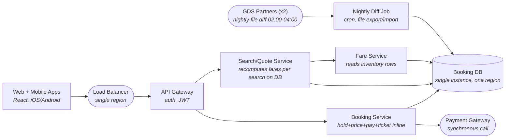

# Skylane Multi Region Booking Settlement Design — Software Design Document

| | |
|---|---|
| **Status** | Documents the current system |
| **Last updated** | 2026-08-16 |

## 1. Introduction & Overview

Skylane is a mid-size airline selling roughly 120,000 seats a day through its own web and mobile channels and through two external GDS partners that feed travel agencies worldwide. Booking is the revenue-critical path: every search, quote, hold, payment and ticket flows through one Spring Boot estate in a single cloud region. The business runs frequent fare sales that multiply search demand nearly tenfold for about two hours, and it settles with GDS partners on schedules that assume shared, correct inventory. Overselling a flight forces involuntary rebooking that is both expensive and reputationally damaging, and any region-wide outage stops sales on every channel at once. The current architecture was adequate at launch volume but now fails under both spike load and partner staleness.

**Objective of this document:** describe the system as it runs today — its architecture, data, interfaces and components. The design goal: Redesign Skylane's airline booking path for multi-region operation, zero oversell, and near-real-time GDS partner sync. Separate search/quote read load from booking writes, model the booking as a compensable saga, and define failover trade-offs.

## 2. System Architecture

Web and mobile clients hit a single-region load balancer and API gateway that terminates auth, then route to a Search/Quote service and a Booking service. Seat inventory lives in one PostgreSQL instance as one row per flight cabin bucket, with tables for inventory_buckets, bookings, fares and tickets. The Search/Quote service and Fare service recompute fare quotes live by reading those same inventory and fare rows on every search. The Booking service runs the entire hold, price, pay and ticket sequence inline inside one request, locking the relevant inventory_buckets row for the duration and calling the external payment gateway synchronously mid-transaction. GDS partners never touch this database directly: a nightly cron job exports a file diff between 02:00 and 04:00 and imports partner-side changes, which is the only mechanism keeping the two worlds in sync.

> The architecture diagram below is the same system that is pre-drawn (locked) on the whiteboard for this task; this repository contains its implementation.

### 2.1 Architecture Diagram (current system)

| Component | Role |
|---|---|
| Web + Mobile Apps | React, iOS/Android |
| GDS Partners (x2) | nightly file diff 02:00-04:00 |
| Load Balancer | single region |
| API Gateway | auth, JWT |
| Search/Quote Service | recomputes fares per search on DB |
| Booking Service | hold+price+pay+ticket inline |
| Fare Service | reads inventory rows |
| Payment Gateway | synchronous call |
| Booking DB | single instance, one region |
| Nightly Diff Job | cron, file export/import |

### 2.2 Known Limitations (observed in production)

During fare sales, search traffic climbs from about 4.1k to 37k QPS and the Booking service's inline transaction contends with search reads on the same inventory rows: row-lock wait hits p99 8.9s, hold-decision p95 blows past its 400ms target to nearly 20s, and checkout p95 reaches 22.4s. Because the GDS diff runs only nightly, agencies book seats the website already sold hours earlier — last quarter this produced 3,100 oversold seats on flights like FL482 and about $2.1M in involuntary rebooking, with no automated reconciliation when the diff import conflicts. There is no cross-region capability, so the two regional incidents this year (40 and 95 minutes) halted sales on every channel simultaneously. The single database is the shared point of contention for reads, writes and partner sync alike.

## 3. Data Design

| Store | Kind | Details |
|---|---|---|
| Booking DB | database | single instance, one region — tables: `inventory_buckets`, `bookings`, `fares`, `tickets` |

Data-layer implementation: `src/main/java/com/skylane/booking/domain/Entities.java`, `src/main/java/com/skylane/booking/repo/Repositories.java`

## 4. Interface Design

External integration points of the current system:

- **Clients** — Web + Mobile Apps.
- **GDS Partners (x2)** — nightly file diff 02:00-04:00.
- **Load Balancer** — single region.
- **Payment Gateway** — synchronous call.

## 5. Component Design

| Component | Implementation |
|---|---|
| API Gateway | `src/main/java/com/skylane/booking/SkylaneBookingApplication.java`, `src/main/java/com/skylane/booking/config/SecurityConfig.java`, `src/main/java/com/skylane/booking/web/BookingController.java` |
| Booking DB | `src/main/java/com/skylane/booking/domain/Entities.java`, `src/main/java/com/skylane/booking/repo/Repositories.java` |
| Fare Service | `src/main/java/com/skylane/booking/service/FareService.java` |
| Search/Quote Service | `src/main/java/com/skylane/booking/service/SearchService.java` |
| Booking Service | `src/main/java/com/skylane/booking/service/BookingService.java` |
| Nightly Diff Job | `src/main/java/com/skylane/booking/batch/GdsNightlyDiffJob.java` |

## 6. Assumptions, Constraints & Scale

The redesign must handle about 120,000 seats sold per day with a sustained booking-write rate of roughly 5-7 per second bursting to about 40 per second at flight open, against an observed search-to-book ratio near 300:1 and fare-sale search spikes of 9x for about two hours. Zero oversell is required across own-channel and GDS combined, and the hold decision must return within a p95 of 400ms even at peak. Partner availability must be stale by no more than 60 seconds under normal operation and no more than 15 minutes while a region or link is degraded. A warm second region must take over selling within 10 minutes of a regional failure with no paid booking lost or double-ticketed, and every booking state transition must be retained auditably for 7 years. The candidate should state assumptions and justify where consistency, availability or latency is traded off per flow.

## 7. Glossary

- **Reconciliation path** — A background process that compares two data paths (authoritative inventory vs partner-claimed inventory) and resolves divergence, correcting or flagging conflicts rather than assuming they never happen.
- **Transactional outbox** — A pattern where a service writes domain changes and an outgoing event to the same database transaction, then a relay publishes the event, guaranteeing the event is never lost even if the service crashes.
- **Saga / compensation workflow** — A long-running business transaction split into steps across services where each step has a compensating action to undo it, used when a single ACID transaction across services is impossible (e.g. hold -> price -> pay -> ticket).
- **RPO (Recovery Point Objective)** — The maximum acceptable amount of data loss measured in time after a failure; here it must be effectively zero for paid bookings during regional failover.
- **Single-writer-per-key (region affinity)** — Assigning ownership of each partition (here, each flight-cabin bucket) to exactly one region/node so writes are serialized without cross-region coordination, trading some availability for consistency.
